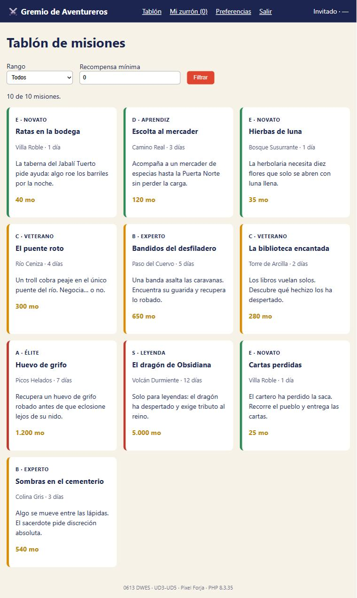
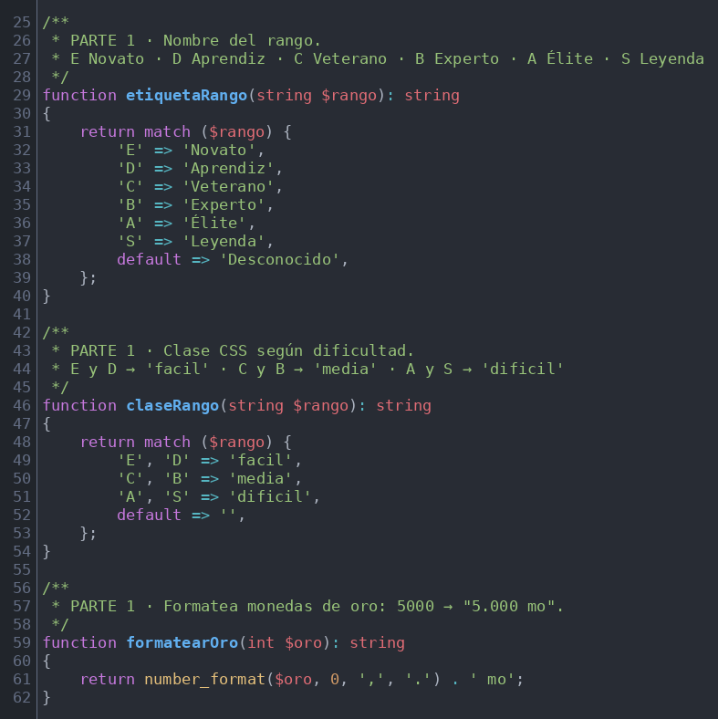
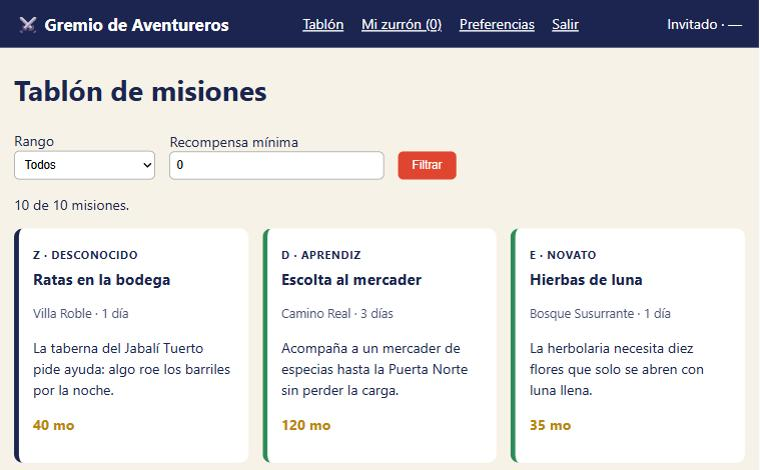

# Memoria · Gremio de Aventureros

**Alumno:** Adrián Hermida Moreno · **Fecha:** 17/11/2026

> Las capturas están en ***capturas/***. La página se abre en el Docker en ***http://localhost:8080/gremio/src/tablon.php***.

Código del ***foreach*** de ***tablon.php*** que pinta una tarjeta por cada misión:

- La clase de cada ***article*** es ***mision*** más la que devuelve ***claseRango()***, y es la que da el color del borde.
- Todo el texto que viene del array pasa por ***e()***, que usa ***htmlspecialchars()***. Así, si un dato tuviera etiquetas HTML, se mostrarían como texto en vez de interpretarse.
- Los días se pintan con ***$mision['dias'] === 1 ? 'día' : 'días'*** para que las misiones de un día salgan en singular.
- La recompensa pasa por ***formatearOro()***, que usa ***number_format($oro, 0, ',', '.')***: sin decimales, con coma decimal y punto de miles. Por eso 5000 sale como «5.000 mo».

## 1. Mi aventurero
- Usuario que he añadido a la tabla: ______
- Comando o pasos que he usado para generar el hash:

## 2. Parte 1 · match
¿Has puesto ***default*** en ***etiquetaRango()***? ¿Qué pasa si llega el rango ***'Z'***? ¿Por qué lo prefieres así?

- **¿He puesto default?** Sí. En ***etiquetaRango()*** el ***default*** devuelve ***'Desconocido'*** y en ***claseRango()*** devuelve una cadena vacía.
- **¿Qué pasa si llega el rango 'Z'?** Para comprobarlo cambié el rango de «Ratas en la bodega» de ***'E'*** a ***'Z'*** en ***inc/datos_misiones.php***.
  - **Con default**, la tarjeta sale como «Z · Desconocido» y sin el color de dificultad, porque ***claseRango()*** devuelve una cadena vacía. El resto del tablón se pinta normal:

    

  - **Sin default**, al llegar a esa tarjeta salta un **Fatal error** ***Uncaught UnhandledMatchError: Unhandled match case 'Z'***. Ningún brazo del ***match*** coincide con ***'Z'*** y, como el ***match*** tiene que devolver siempre un valor, lanza una excepción que nadie captura. El script se para ahí y no se pinta ninguna misión más:

    

  Después de la prueba volví a dejar el rango en ***'E'*** y el ***default*** en su sitio.
- **¿Por qué lo prefiero así?** Aquí las funciones solo sirven para mostrar datos, y no tiene sentido que una misión con un rango mal escrito tire abajo todo el tablón. Con el ***default*** el error se ve en esa tarjeta concreta («Desconocido» y sin color) y las demás misiones se siguen mostrando. Además, cuando las misiones pasen a la base de datos no se podrá controlar desde el código qué rango llega.

## 3. Parte 2 · Validación de la URL
Escribe a mano en la barra ***tablon.php?rango=Z&oro=hola***. ¿Qué ocurre y qué línea de tu código lo evita?

## 4. Parte 3 · Sesión frente a cookie
Explica con tus palabras qué guardas en ***$_SESSION*** y qué guardas en cookies, y por qué no al revés.

## 5. Parte 3 · Seguridad del login
- ¿Qué pasa si en el usuario escribes ***' OR '1'='1***? ¿Por qué?
- ¿Para qué sirve ***session_regenerate_id(true)***?
- ¿Por qué el mensaje de error es el mismo si falla el usuario o la contraseña?

## 6. Pruebas
| Prueba | Resultado esperado | Resultado obtenido |
|---|---|---|
| Abrir tablon.php | 10 tarjetas con borde verde, naranja o rojo según el rango | 10 tarjetas: 4 verdes (E y D), 4 naranjas (C y B) y 2 rojas (A y S) |
| Misiones de 1 día | «1 día» en singular | Ratas en la bodega, Hierbas de luna y Cartas perdidas salen con «1 día» |
| Formato del oro | 5000 → «5.000 mo» | El dragón de Obsidiana sale con «5.000 mo» y Huevo de grifo con «1.200 mo» |
| Entrar en tablon.php sin login | | |
| Login con contraseña mala | | |
| Aceptar la misma misión dos veces | | |
| Cerrar sesión y volver al zurrón | | |
| Cambiar el tema y cerrar sesión | | |

## 7. Dificultades y cómo las he resuelto

## 8. Conocimientos adquiridos
- ***match*** devuelve un valor, compara con ***===*** y no necesita ***break***.
- En un mismo brazo de ***match*** se pueden poner varios valores separados por comas.
- Si ningún brazo coincide y no hay ***default***, ***match*** lanza ***UnhandledMatchError*** y el script se para.
- ***number_format()*** recibe el número, los decimales, el separador decimal y el de miles.
- Con la sintaxis ***foreach (...):*** y ***endforeach;*** el PHP mezclado con HTML se lee mejor.
- Todo dato que se pinta en HTML se escapa con ***htmlspecialchars()*** para evitar XSS.
