# Memoria · Gremio de Aventureros

**Alumno:** Adrián Hermida Moreno · **Fecha:** 25/11/2026

> Las capturas están en ***capturas/***. En mi Docker la página se abre en ***http://localhost:8080/gremio/src/***.

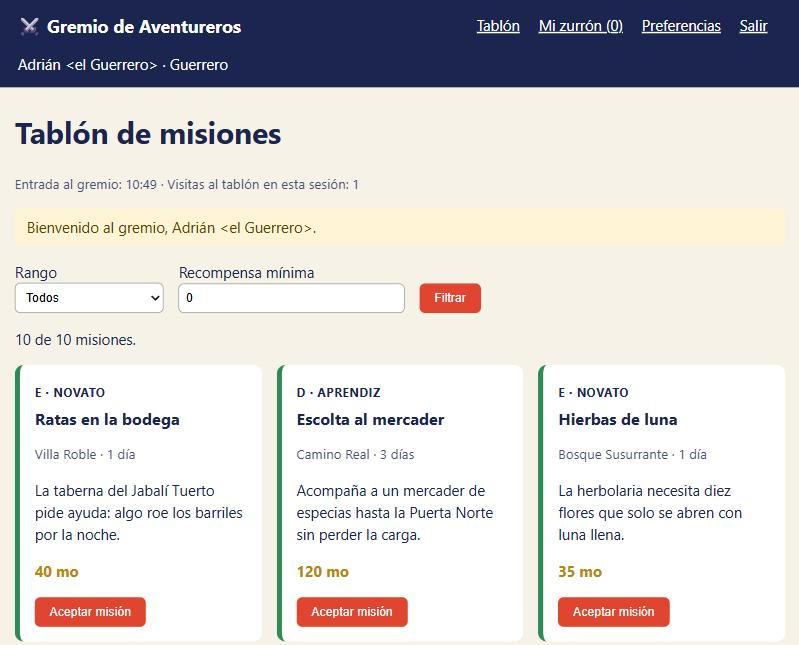

Código del ***foreach*** de ***tablon.php*** que pinta una tarjeta por cada misión:

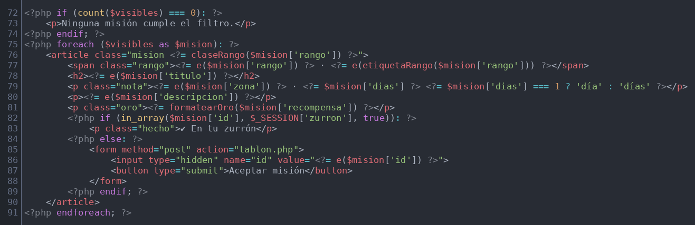

- La clase de cada ***article*** es ***mision*** más la que devuelve ***claseRango()***, que es la que da el color del borde.
- Todo el texto que viene del array pasa por ***e()***, que usa ***htmlspecialchars()***. Así, si un dato tuviera etiquetas HTML, se mostrarían como texto en vez de interpretarse.
- Los días se pintan con ***$mision['dias'] === 1 ? 'día' : 'días'*** para que las misiones de un día salgan en singular.
- La recompensa pasa por ***formatearOro()***, que usa ***number_format($oro, 0, ',', '.')***: sin decimales, con coma decimal y punto de miles. Por eso 5000 sale como «5.000 mo».
- Si la misión ya está en el zurrón sale «✔ En tu zurrón»; si no, el botón **Aceptar misión**, que es un formulario POST con el id en un ***input*** oculto.

## 1. Mi aventurero
- Usuario que he añadido a la tabla: ***adrian*** (nombre «Adrián &lt;el Guerrero&gt;», clase Guerrero). Contraseña de prueba: ***Gremio2026***.
- Comando o pasos que he usado para generar el hash:
  1. Generé el hash desde la línea de comandos de PHP: ***php -r "echo password_hash('Gremio2026', PASSWORD_DEFAULT), PHP_EOL;"***
  2. Copié el resultado (empieza por ***$2y$10$***, que es bcrypt) en el INSERT de ***sql/mi_aventurero.sql***.
  3. Importé ***gremio.sql*** y después ***mi_aventurero.sql*** en la base de datos.

  En la tabla solo se guarda el hash. Cada vez que se genera sale uno distinto porque lleva una sal aleatoria, y ***password_verify()*** es la que sabe comprobar si una contraseña corresponde a ese hash.

## 2. Parte 1 · match
¿Has puesto ***default*** en ***etiquetaRango()***? ¿Qué pasa si llega el rango ***'Z'***? ¿Por qué lo prefieres así?

- **¿He puesto default?** Sí. En ***etiquetaRango()*** el ***default*** devuelve ***'Desconocido'*** y en ***claseRango()*** devuelve una cadena vacía.
- **¿Qué pasa si llega el rango 'Z'?** Para comprobarlo cambié el rango de «Ratas en la bodega» de ***'E'*** a ***'Z'*** en ***inc/datos_misiones.php***.
  - **Con default**, la tarjeta sale como «Z · Desconocido» y sin el color de dificultad, porque ***claseRango()*** devuelve una cadena vacía. El resto del tablón se pinta normal:

    

  - **Sin default**, al llegar a esa tarjeta salta un **Fatal error** ***Uncaught UnhandledMatchError: Unhandled match case 'Z'***. Ningún brazo del ***match*** coincide con ***'Z'*** y, como el ***match*** tiene que devolver siempre un valor, lanza una excepción que nadie captura. El script se para ahí y no se pinta ninguna misión más:

    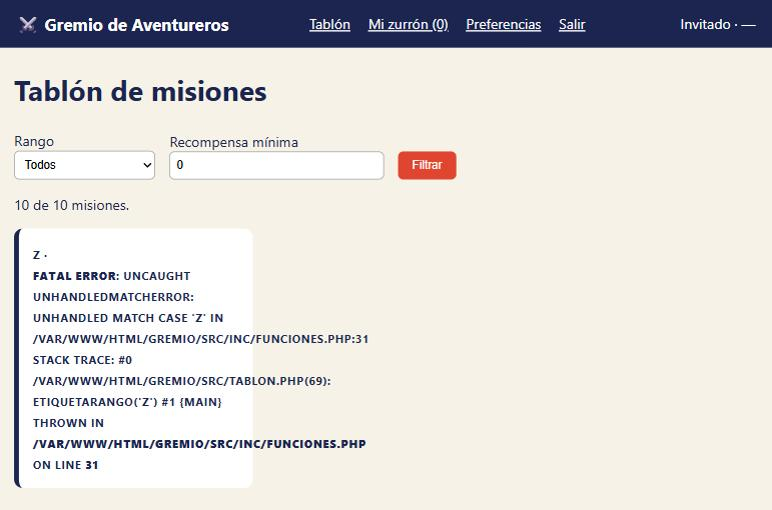

  Después de la prueba volví a dejar el rango en ***'E'*** y el ***default*** en su sitio.
- **¿Por qué lo prefiero así?** Aquí las funciones solo sirven para mostrar datos, y no tiene sentido que una misión con un rango mal escrito tire abajo todo el tablón. Con el ***default*** el error se ve en esa tarjeta concreta («Desconocido» y sin color) y las demás misiones se siguen mostrando. Además, cuando las misiones pasen a la base de datos no se podrá controlar desde el código qué rango llega.

## 3. Parte 2 · Validación de la URL
Escribe a mano en la barra ***tablon.php?rango=Z&oro=hola***. ¿Qué ocurre y qué línea de tu código lo evita?

Salen las 10 misiones, sin ningún Warning. El desplegable se queda en «Todos» y el campo de recompensa mínima en 0, como si no se hubiera filtrado.

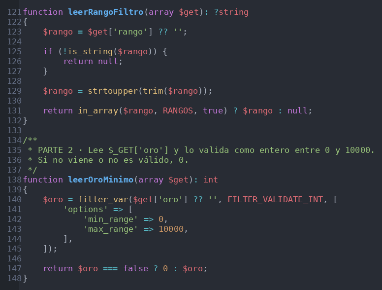

- **Rango:** la línea ***return in_array($rango, RANGOS, true) ? $rango : null;*** de ***leerRangoFiltro()*** comprueba que el rango esté en la constante ***RANGOS***. ***'Z'*** no está, así que devuelve ***null*** y ***filtrarMisiones()*** no filtra por rango. Antes paso el valor a mayúsculas con ***strtoupper()***, así que ***?rango=b*** también funciona. El ***is_string()*** está porque alguien puede escribir ***?rango[]=x*** y entonces llega un array.
- **Oro:** en ***leerOroMinimo()***, ***filter_var()*** con ***FILTER_VALIDATE_INT*** y las opciones ***min_range*** 0 y ***max_range*** 10000 devuelve ***false*** si el valor no es un entero o se sale del rango. ***'hola'*** no es un entero, y la línea ***return $oro === false ? 0 : $oro;*** lo convierte en 0.

También probé ***oro=-1***, ***oro=10001***, ***oro=5.5*** y ***oro=*** (vacío): en todos se queda en 0. ***oro=10000*** sí es válido, y no sale ninguna misión porque ninguna paga tanto.

**Filtros y cálculo.** ***filtrarMisiones()*** recorre las misiones con ***foreach*** y va metiendo en un array nuevo las que cumplen el rango y el oro mínimo. ***totalRecompensa()*** recorre los ids del zurrón y, para cada uno, reutiliza ***buscarMision()***; si un id no existe, no suma nada:

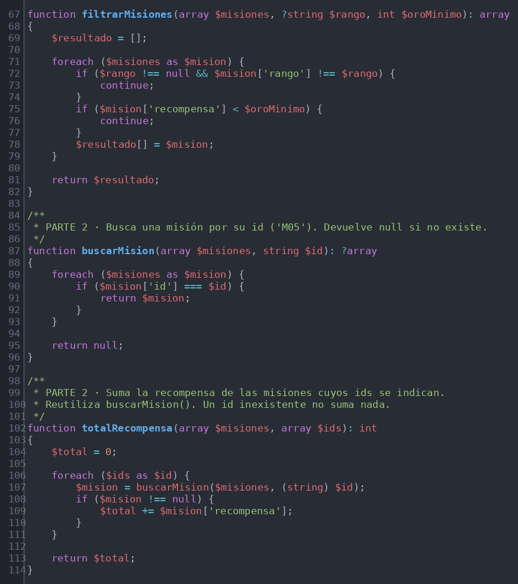

Con rango B y oro mínimo 500 salen 2 misiones:

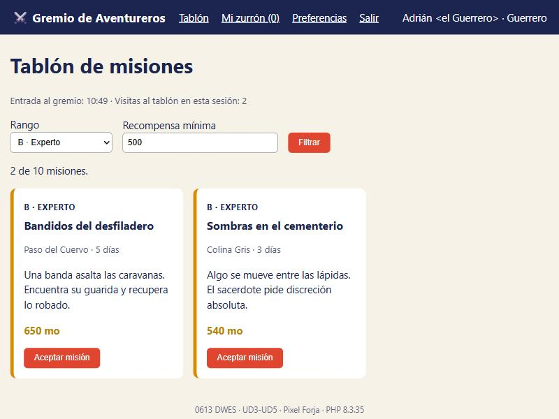

**Aceptar misiones (POST + Post/Redirect/Get).** Al aceptar, busco la misión con ***buscarMision()***. Si no existe o ya está en el zurrón, solo se guarda un mensaje flash de aviso y no se añade nada. Al final siempre se hace ***header('Location: tablon.php')*** y ***exit***, así la última petición del navegador es un GET y al pulsar F5 no se vuelve a enviar el formulario.

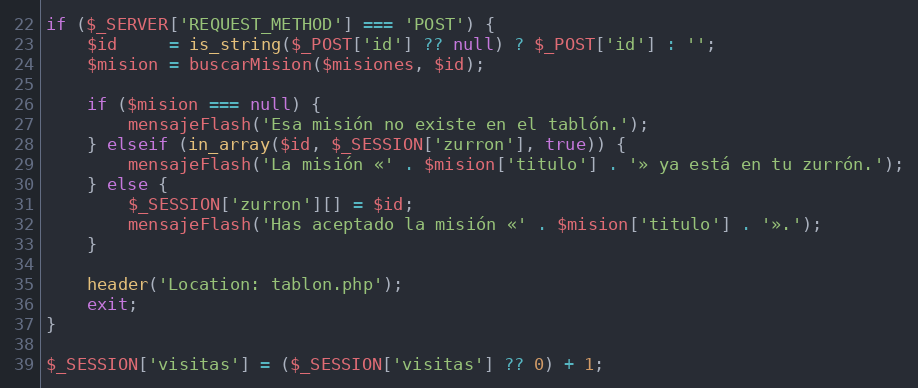

Si se envía otra vez el id de una misión que ya está aceptada (por ejemplo desde otra pestaña), sale el aviso y en el zurrón sigue habiendo una sola:

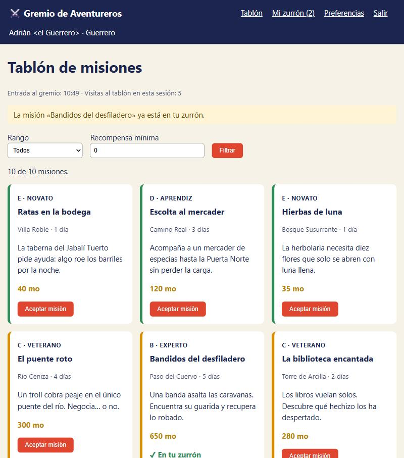

**Zurrón.** ***zurron.php*** pinta una tabla con las misiones aceptadas, el botón **Abandonar** de cada una y la recompensa total. Con «Bandidos del desfiladero» y «El dragón de Obsidiana» el total es 5.650 mo:

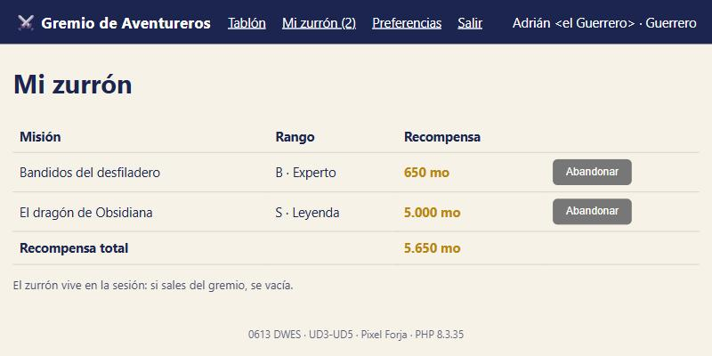

Para abandonar uso ***array_search(..., true)*** para encontrar la posición del id, ***unset*** para quitarlo y ***array_values*** para que los índices vuelvan a quedar seguidos. Después de abandonar «Bandidos del desfiladero» el total se recalcula a 5.000 mo:

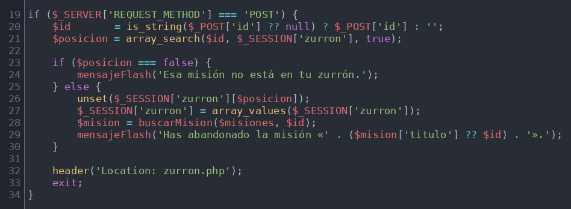

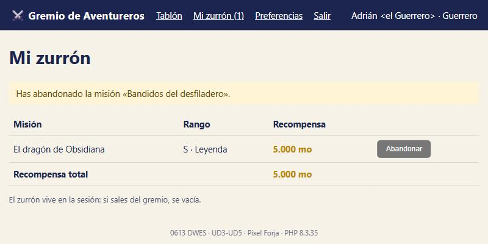

## 4. Parte 3 · Sesión frente a cookie
Explica con tus palabras qué guardas en ***$_SESSION*** y qué guardas en cookies, y por qué no al revés.

- **En $_SESSION** guardo el aventurero que ha entrado (id, usuario, nombre y clase, sin el hash), el zurrón con los ids de las misiones aceptadas, la hora de entrada, el contador de visitas al tablón y los mensajes flash. Todo eso se queda en el servidor; el navegador solo tiene la cookie ***PHPSESSID*** con el identificador de la sesión.
- **En cookies propias** guardo dos cosas pequeñas y que no son delicadas: el tema (***gremio_tema***, un año) y el nombre de usuario para rellenar el login (***gremio_usuario***, 30 días). Nunca la contraseña.
- **¿Por qué no al revés?** Lo que hay en una cookie lo puede cambiar el usuario desde F12. Si guardara en una cookie quién ha iniciado sesión, cualquiera podría escribir otro usuario y entrar como él. Lo de la sesión no se puede tocar desde el navegador, así que lo importante va ahí. Al revés, el tema y el usuario recordado tienen que durar más que la sesión, y por eso van en cookies con su propia caducidad.

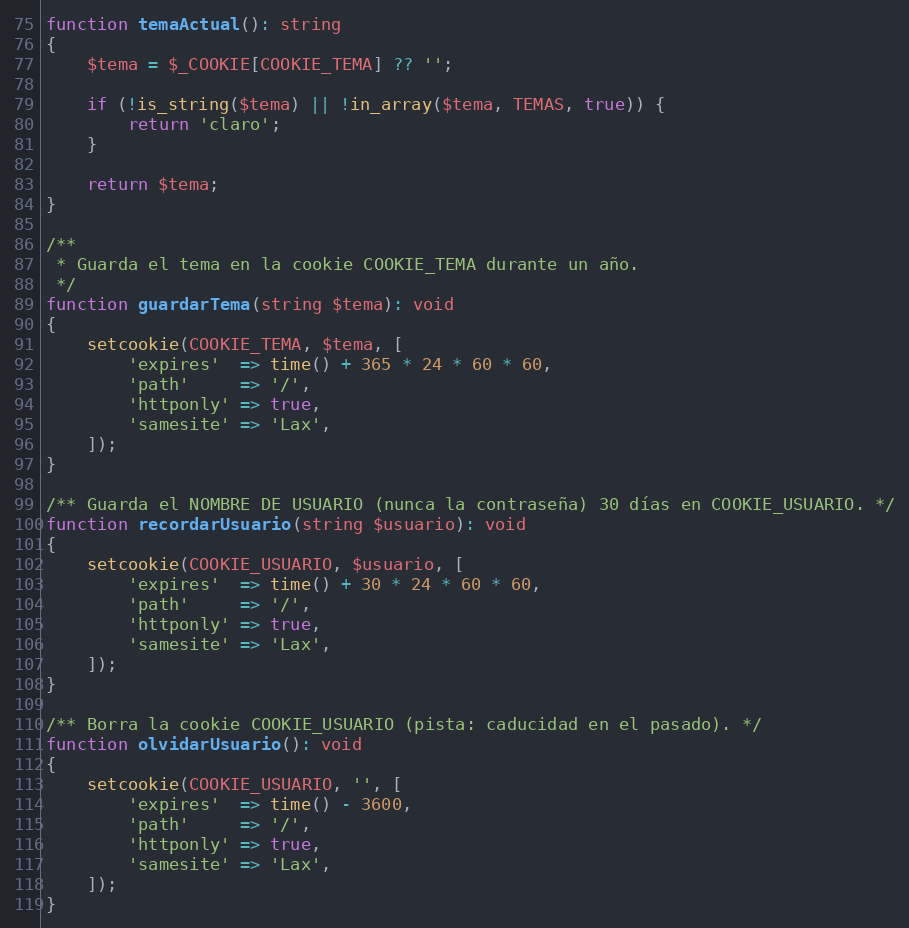

- Las tres cookies se crean con el array de opciones de ***setcookie()***: ***expires***, ***path '/'***, ***httponly*** y ***samesite 'Lax'***. Para borrar ***gremio_usuario*** pongo la caducidad en el pasado.
- ***temaActual()*** no se fía de la cookie: si el valor no está en ***TEMAS*** devuelve ***'claro'***.

En ***preferencias.php*** se valida también lo que llega por POST antes de guardarlo:

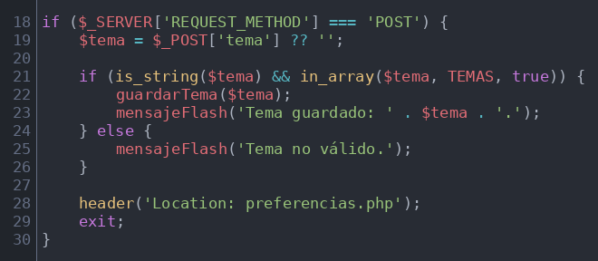

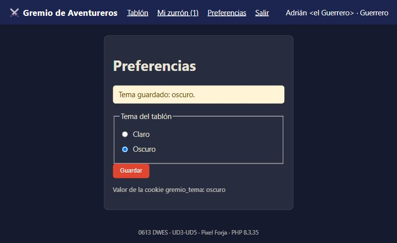

**¿Por qué el tema y el usuario sobreviven al cierre de sesión y el zurrón no?** ***cerrarSesion()*** vacía ***$_SESSION***, caduca la cookie de sesión y llama a ***session_destroy()***, así que el zurrón, que vive en la sesión, desaparece. Las cookies ***gremio_tema*** y ***gremio_usuario*** son independientes de la sesión, tienen su propia fecha de caducidad y ***logout.php*** no las toca. Por eso, después de salir, el login sigue en tema oscuro y con el usuario relleno, pero el zurrón está vacío:

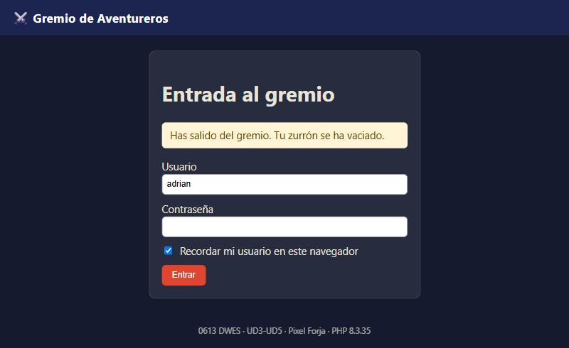

**Cookie manipulada (prueba 8).** Puse a mano ***gremio_tema*** con el valor ***hackeado&lt;script&gt;alert(1)&lt;/script&gt;***. La página se pinta en tema claro, porque ***temaActual()*** no acepta ese valor, y el texto no llega a la clase del ***body***. En preferencias se muestra el valor crudo de la cookie, pero escapado con ***e()***, así que sale como texto y el script no se ejecuta:

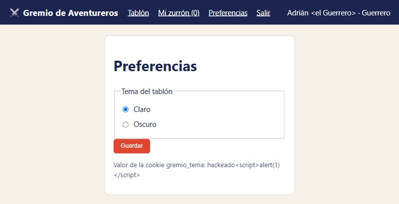

**Contador de visitas.** En la UD2 el contador siempre valía 1 porque PHP empieza de cero en cada petición. Ahora sumo 1 a ***$_SESSION['visitas']*** cada vez que se carga el tablón, y como la sesión se guarda en el servidor entre peticiones, el número va subiendo. En la primera captura de esta memoria se ve junto a la hora de entrada.

## 5. Parte 3 · Seguridad del login
- **¿Qué pasa si en el usuario escribes ' OR '1'='1? ¿Por qué?** No entra y sale «Usuario o contraseña incorrectos.», igual que con cualquier usuario que no existe. La consulta de ***autenticar()*** es preparada, con el marcador ***:usuario***. El texto que escribe el usuario se manda aparte como dato y MySQL lo trata como un nombre de usuario literal, nunca como parte de la SQL. Como no hay ningún usuario que se llame así, no devuelve ninguna fila.

  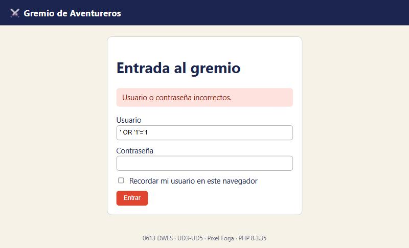

  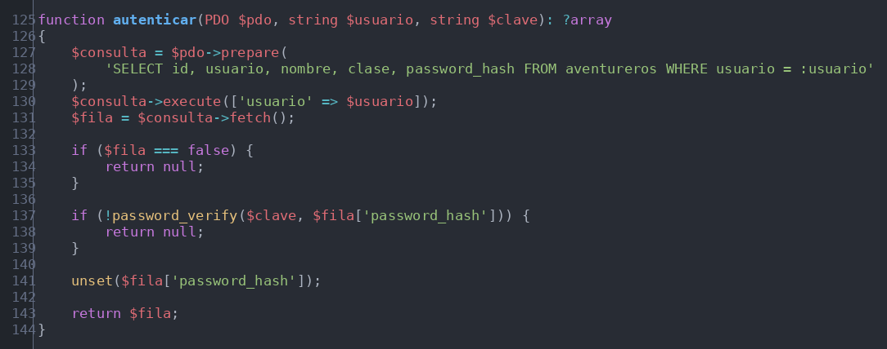

  Si encuentra la fila, ***password_verify()*** compara la contraseña con el hash, y antes de devolver el aventurero le quito el hash con ***unset***, para que no acabe guardado en la sesión.

- **¿Para qué sirve session_regenerate_id(true)?** Cambia el identificador de la sesión justo cuando el usuario inicia sesión y borra la sesión antigua. Así, si alguien hubiera conseguido el id de antes de entrar (por ejemplo, haciendo que la víctima use un id que él ya conoce), ese id deja de servir. Es la defensa contra la fijación de sesión.

- **¿Por qué el mensaje de error es el mismo si falla el usuario o la contraseña?** Si dijera «ese usuario no existe» o «contraseña incorrecta» por separado, alguien podría ir probando nombres y saber cuáles existen en el gremio. Con un mensaje único no se da esa pista.

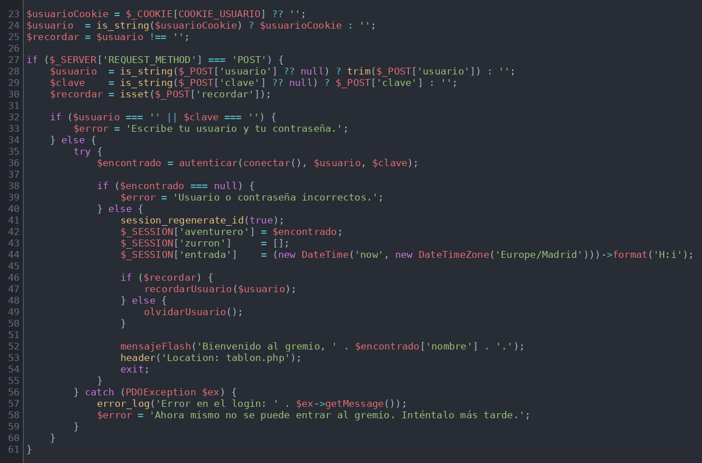

- Si falta el usuario o la contraseña, sale «Escribe tu usuario y tu contraseña.» y no se llega a consultar la base de datos.
- Si falla la conexión, el ***catch*** de ***PDOException*** manda el detalle técnico a ***error_log()*** y al usuario solo le enseña un mensaje genérico.
- Al entrar se guarda el aventurero en la sesión, se empieza el zurrón vacío, se apunta la hora de entrada y se guarda o se borra la cookie de usuario según la casilla «Recordar».

**Páginas protegidas.** ***tablon.php***, ***zurron.php*** y ***preferencias.php*** llaman a ***requiereLogin()*** al principio. Si no hay aventurero en la sesión, redirige a ***login.php?motivo=privado*** y hace ***exit***, para que no se ejecute nada más de la página:

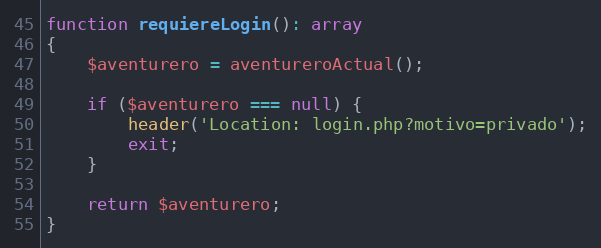

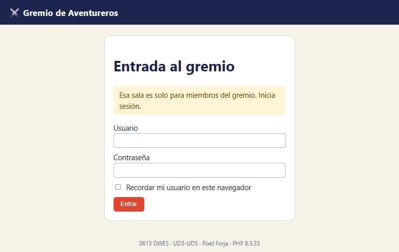

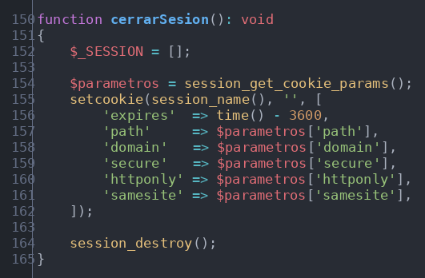

## 6. Pruebas
| # | Prueba | Resultado esperado | Resultado obtenido |
|---|---|---|---|
| 1 | Abrir tablon.php sin haber iniciado sesión | Redirige al login con el aviso «solo para miembros» | Redirige a login.php?motivo=privado con «Esa sala es solo para miembros del gremio». Lo mismo con zurron.php y preferencias.php |
| 2 | Login con contraseña incorrecta | «Usuario o contraseña incorrectos.» | Sale ese mensaje, igual que con un usuario que no existe |
| 3 | Usuario ' OR '1'='1 y cualquier contraseña | Mismo mensaje de error: no entra | «Usuario o contraseña incorrectos.» y se queda en el login |
| 4 | Login correcto con «Recordar» | Entra; al salir, el login aparece con el usuario relleno | Entra al tablón; al salir aparece «adrian» y la casilla marcada. Si entro sin marcarla, al salir el campo sale vacío |
| 5 | Aceptar la misma misión dos veces / pulsar F5 | No se duplica; F5 no reenvía el formulario | Sale «ya está en tu zurrón» y sigue habiendo una. Después del POST hay redirección, y F5 no pregunta por reenviar |
| 6 | Recargar el tablón varias veces | El contador de visitas sube | Sube de uno en uno en cada recarga |
| 7 | Cambiar el tema y cerrar sesión | El tema se mantiene; el zurrón se vacía | El login sale en tema oscuro y al volver a entrar el zurrón está a 0 |
| 8 | Editar a mano la cookie gremio_tema con texto raro | La página usa el tema claro y no pinta el texto | Tema claro; el valor no aparece en el ***body*** y en preferencias sale escapado |
| 9 | tablon.php?rango=Z&oro=hola | Muestra las 10 misiones sin errores | 10 misiones, sin avisos |
| 10 | Entrar con tu propio aventurero | Funciona | Entro con ***adrian*** y arriba sale «Adrián &lt;el Guerrero&gt; · Guerrero» |
| E1 | Abrir el tablón | 10 tarjetas con color por rango | 10 tarjetas: 4 verdes (E y D), 4 naranjas (C y B) y 2 rojas (A y S) |
| E1 | Rango B y oro mínimo 500 | 2 misiones | Bandidos del desfiladero y Sombras en el cementerio |
| E1 | Aceptar Bandidos del desfiladero y El dragón de Obsidiana | Total 5.650 mo | 5.650 mo; al abandonar Bandidos, 5.000 mo |

## 7. Dificultades y cómo las he resuelto
- **Mi Docker no es el docker-lamp del kit.** En mi entorno la web sale por el puerto 8080, no hay phpMyAdmin y la base de datos se llama ***dwes_db***. ***inc/conexion.php*** (que no se puede tocar) lee las variables ***MYSQL_HOST***, ***MYSQL_DATABASE***, ***MYSQL_USER*** y ***MYSQL_PASSWORD***, pero mi ***docker-compose.yml*** le pasa al contenedor de PHP otras distintas (***DB_HOST***, ***DB_NAME***…). Al no encontrarlas, coge los valores por defecto: servidor ***db***, base ***dbname*** y usuario ***dbuser*** sin contraseña. Lo resolví creando en MySQL la base ***dbname*** y el usuario ***dbuser*** con permisos sobre ella, e importando ahí ***gremio.sql*** y ***mi_aventurero.sql***. Así no hizo falta cambiar ningún archivo del kit.
- **Un array en la URL rompía leerOroMinimo().** Con ***?oro[]=1*** la función devolvía ***false*** en vez de un ***int***, y por el ***strict_types*** saltaba un ***TypeError***. Lo arreglé comprobando a mano si ***filter_var()*** devuelve ***false***.

## 8. Conocimientos adquiridos
- ***match*** devuelve un valor, compara con ***===*** y no necesita ***break***. Si ningún brazo coincide y no hay ***default***, lanza ***UnhandledMatchError***.
- ***number_format()*** recibe el número, los decimales, el separador decimal y el de miles.
- Todo dato que se pinta en HTML se escapa con ***htmlspecialchars()*** para evitar XSS.
- Nunca hay que fiarse de ***$_GET***, ***$_POST*** ni ***$_COOKIE***: se validan con ***in_array(..., true)*** o con ***filter_var()***, y pueden llegar como array.
- Patrón Post/Redirect/Get: después de procesar un POST se redirige con ***header('Location: ...')*** y ***exit*** para que F5 no repita la acción.
- La sesión guarda los datos en el servidor y el navegador solo tiene el id (***PHPSESSID***). Las cookies guardan los datos en el navegador y el usuario las puede cambiar.
- ***setcookie()*** con array de opciones: ***expires***, ***path***, ***httponly*** (JavaScript no puede leerla) y ***samesite 'Lax'***. Para borrar una cookie se le pone una caducidad pasada. ***$_COOKIE*** no cambia hasta la siguiente petición.
- Cerrar sesión bien es vaciar ***$_SESSION***, caducar la cookie de sesión y llamar a ***session_destroy()***.
- Las consultas preparadas con marcadores (***:usuario***) evitan la inyección SQL.
- Las contraseñas se guardan con ***password_hash()*** y se comprueban con ***password_verify()***.
- ***session_regenerate_id(true)*** al iniciar sesión evita la fijación de sesión.
- Después de una redirección con ***header()*** hay que poner ***exit***, o el resto de la página se sigue ejecutando.

## 9. Uso de IA
Sí, he utilizado inteligencia artificial durante el desarrollo del reto, como herramienta de apoyo.

La he usado principalmente para entender cómo funcionan las sesiones y las cookies en PHP, para resolver los problemas del entorno Docker (la conexión con la base de datos) y para revisar el código y las pruebas cuando algo no salía como esperaba.

También me ha ayudado a ordenar y redactar algunas explicaciones de esta memoria y a preparar las capturas del código. Todas las pruebas las he comprobado en mi entorno antes de incluirlas, y he revisado el contenido para entenderlo antes de añadirlo a la memoria.
